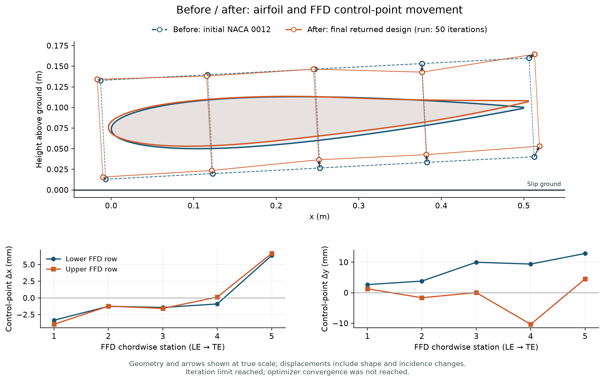

# Front Wing Optimization

MACH-Aero CFD and adjoint-based optimization of a racing-car front-wing section in ground effect. The project code, input meshes, flow solutions, plots, run settings, and optimization histories are in [`aero588_project/`](aero588_project/README.md).

The latest configuration uses a 0.5 m initial chord, 200 km/h freestream, slip ground, free incidence, and five upper/lower FFD pairs with independent x/y movement. It maximizes downforce with CD ≤ 0.05 and actual-surface box/thickness constraints.

| Optimization run | Downforce increase | Independent CFD check | Status |
|---|---:|---:|---|
| [October 27, y-only shape changes](aero588_project/optimizations/slip_ground_box_20261027/README.md) | 15.26% | 15.13% | 50-iteration limit; stationarity not reached |
| [October 29, five-pair x/y changes](aero588_project/optimizations/slip_ground_xy5_cd005_20261029/README.md) | 29.28% | 29.05% | 50-iteration limit; stationarity not reached |

The two runs use different drag caps and parameterizations. They are preliminary single-grid results. The independent checks rebuild overset connectivity on the same mesh; they do not establish grid independence.

- [Current project description and model](aero588_project/README.md)
- [Latest results table](aero588_project/optimizations/slip_ground_xy5_cd005_20261029/comparison_results.txt)
- [Latest CFD and optimizer settings](aero588_project/optimizations/slip_ground_xy5_cd005_20261029/settings.txt)
- [Latest comparison plots](aero588_project/optimizations/slip_ground_xy5_cd005_20261029/plots)
- [Reproduction instructions and prepared inputs](aero588_project/setups/slip_ground_xy5_cd005/README.md)
- [Separate moving no-slip ground extension](aero588_project/solver_extensions/moving_wall/README.md)
