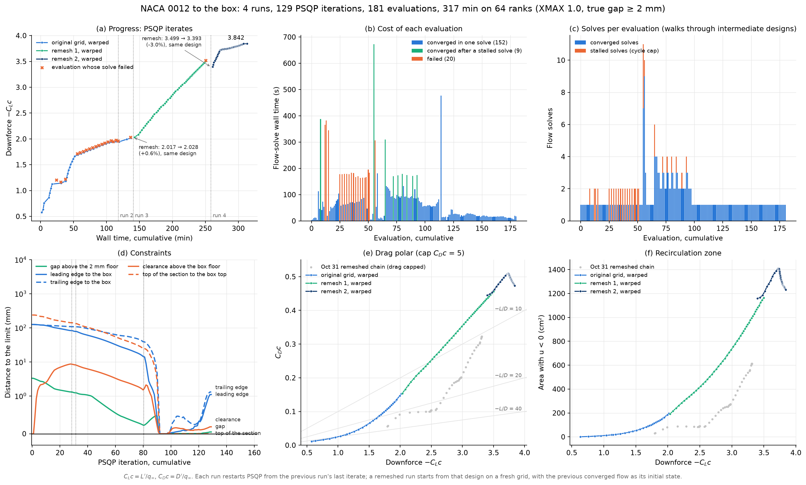
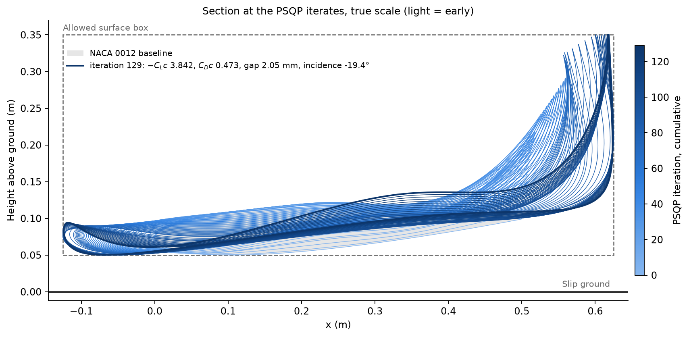
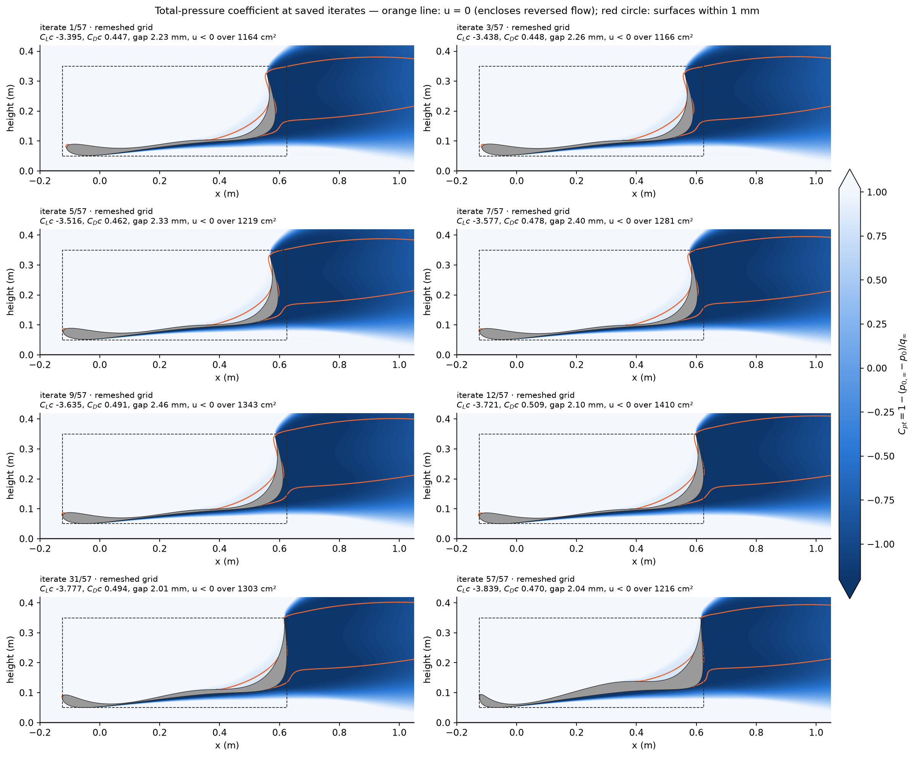

# From NACA 0012 to the corner of the box, November 1

Goal: push the clean run ([`clean_xmax1.0_gap2mm_20261101`](../clean_xmax1.0_gap2mm_20261101)) on until the section reaches the box limits, under the same settings:
- XMAX 1.0;
- the true-gap floor of 2 mm;
- a drag cap high enough never to bind (C_D·c 5).

Everything ran on 64 ranks. Forces are C_L·c = L′/q∞ and C_D·c = D′/q∞.

**Result: the section reached the corner, with every limit active.**
- **Corner reached:** at cumulative PSQP iteration 91 (C_L·c −3.72), the leading edge, trailing edge, top of the box, ground clearance and the 2 mm gap were all within a millimetre of their limits. The trailing edge was in the box's upper-right corner.
- **Riding the limits:** PSQP kept improving for 37 more iterations, then its line search stalled.
- **Best design:** evaluation 64 of the last run, at C_L·c **−3.842** and C_D·c 0.473 (downforce/drag 8.1, 7.26 kN/m of downforce at 200 km/h). It is fully converged (residual 7e-11 of the initial) and feasible.

| Limit | Best design | Limit |
|---|---:|---:|
| Leading edge x | −0.1239 m | ≥ −0.125 m |
| Trailing edge x | 0.6237 m | ≤ 0.625 m |
| Top of the section | 0.35000 m | ≤ 0.35 m |
| Ground clearance | 50.2 mm | ≥ 50 mm |
| Thinnest true gap | 2.05 mm | ≥ 2 mm |
| Chord, incidence | 0.786 m, −19.4° | free |





## How it went

| Run | Grid | PSQP iterations | Evaluations | Solves (stalled) | Failed evaluations | Evaluation time | C_L·c |
|---|---|---:|---:|---:|---:|---:|---|
| [clean](../clean_xmax1.0_gap2mm_20261101) | original, warped | 28 | 52 | 71 (37) | 18 | 118 min | −0.576 → −1.939 |
| [continuation](../box_xmax1.0_gap2mm_20261101) | original, warped | 3 | 6 | 27 (5) | 1 | 20 min | −1.939 → −2.017 |
| [remesh 1](../box_remesh1_xmax1.0_gap2mm_20261101) | remeshed at −2.017 | 49 | 56 | 115 (8) | 1 (negative volumes) | 113 min | −2.028 → −3.499 |
| [remesh 2](../box_remesh2_xmax1.0_gap2mm_20261101) | remeshed at −3.499 | 49 | 67 | 67 (0) | 0 | 67 min | −3.393 → −3.842 |

That is 129 PSQP iterations and 317 min of evaluations. Clock time was 06:43–12:53, including the hand-overs between runs.

1. **Clean run** (06:43–08:41): see its README. Its full steps stalled at the 10000-cycle cap from C_L·c −1.67 on.
2. **Continuation on the same grid** (09:17–09:41) introduced `--split-stalled-solves`:
   - A stalled solve is retried through intermediate designs on the straight line from the last converged design.
   - A stalled step is halved and retried from its own converged start, down to 1/16 of the way.
   - The step length that worked is reused for later evaluations and grows back 1.25× after each clean one.

   PSQP then saw no failure for evaluation 3, but on this grid even 1/16 steps were stalling, so a single step could cost 11 solves (11 min).
3. **Remesh 1** at evaluation 5 (C_L·c −2.017):
   - `remesh_design.py`, with the October `cMax` 1.0 and 30 smoothing iterations, produced a clean grid in 10 s.
   - Solved from freestream, the new grid was still converging after 60000 cycles. Restarting instead from the old grid's converged flow at the same design (the blocks have the same dimensions) converged in 3 min.
   - The derivative check, taken at incidence −3.02° off the warp's kink at zero, agreed to 0.6%.
   - From there, full steps went through with occasional one-step stalls. The walk's step length grew back to unlimited after about 35 iterations, and every solve converged until evaluation 55: there the warp inverted one near-body cell above the rising trailing edge (x 0.558 m, y 0.330 m).
4. **Remesh 2** at evaluation 54 (C_L·c −3.499), set up the same way:
   - The derivative check agreed to 0.12%, and no solve stalled.
   - The leading edge, trailing edge, top of the box, clearance and gap all reached their limits 11–12 iterations later (evaluations 16–17).
   - With all of them active, C_L·c went from −3.728 to −3.842 while C_D·c fell from 0.509 to 0.473 and the recirculation area from 1413 to 1232 cm².
   - After evaluation 53, PSQP's line search found nothing better in 13 tries (best: evaluation 64, equal to 53 within 0.0001). The gradient norm was still 0.1, so this is a stalled line search, not a converged optimum, and a restart might gain a little more.

## Findings

1. **Remeshing, not shorter steps, cured the stalled solves.**
   - On the original grid, late in its life, solves stalled even on 1/16 steps.
   - On remesh 1, each of the 8 stalls was recovered within its evaluation, with steps a quarter to a half of the way. On remesh 2, nothing stalled at all.
   - Walking through intermediate designs is still worth keeping: it turned remesh 1's eight stalls into converged evaluations that PSQP never saw fail.
2. **A fresh grid needs a warm start.** At this design (about 1200 cm² of reversed flow), the segregated turbulence solve from freestream converges very slowly. The previous grid's converged flow at the same design loads directly as a restart, because the block dimensions match, and cuts the first solve from more than 8 min to 3–8 min.
3. **The grid moves the answer by a few percent.** Re-solving the same design on a fresh grid changed C_L·c by +0.6% (remesh 1, at −2.02) and by −3.0% (remesh 2, at −3.50), panel (a). So the heavily warped remesh-1 grid had been overpredicting downforce by about 3% by the end. The final −3.842 comes from a grid warped much less (remesh 2), but no grid-convergence study has been done.
4. **The design is a ground-effect ramp ending in a near-vertical wall in the box's upper-right corner.** Drag costs nothing here, so PSQP bought downforce with separation:
   - The ground side stays attached and accelerates under the section.
   - The aft section stands nearly vertical, up to the top of the box, with reversed flow behind it over 1200–1400 cm². The upper surface separates from x ≈ 0.38 m.
   - At C_L·c −3.31, this path needs C_D·c 0.42. The drag-capped October 31 chain reached the same downforce at 0.32, though by pinching the section shut.

   
5. **The final number needs an unsteady check.** A near-vertical wall with a bubble this size is a bluff body. Steady RANS converges here, but the real flow is likely to shed vortices. Until an unsteady (URANS) run checks the final design, treat its downforce and drag as the steady model's answer, not the physical one.

The last Cpt panel is evaluation 65, the final trial; the best design is evaluation 64, at C_L·c −3.842 (the gradient pass saves every gradient evaluation).

## Reproduction

The remeshes are in [`../remesh_20261101`](../remesh_20261101), each with its source design and pyHyp log. Each run's `command.txt` records its command, its grid and initial flow, and why it was stopped.

```
python scripts/plot_iterate_flows.py --out optimizations/<run> --name <run without _gap2mm_20261101> optimizations/<run>
python scripts/plot_run_chain.py --out optimizations/box_summary_20261101 \
    optimizations/clean_xmax1.0_gap2mm_20261101 optimizations/box_xmax1.0_gap2mm_20261101 \
    optimizations/box_remesh1_xmax1.0_gap2mm_20261101 optimizations/box_remesh2_xmax1.0_gap2mm_20261101
```
