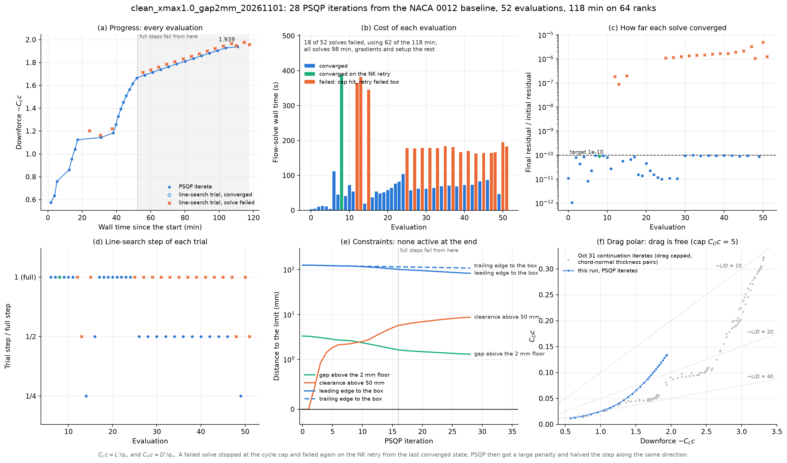
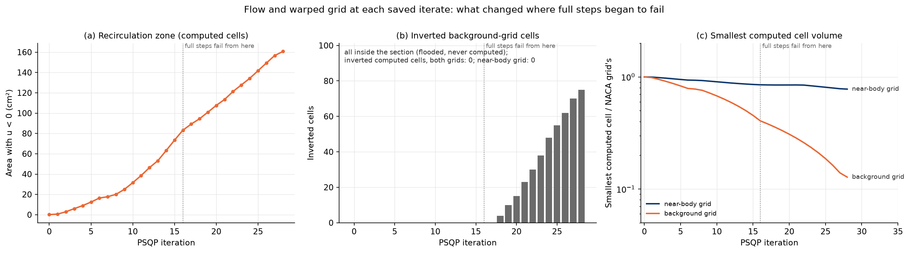
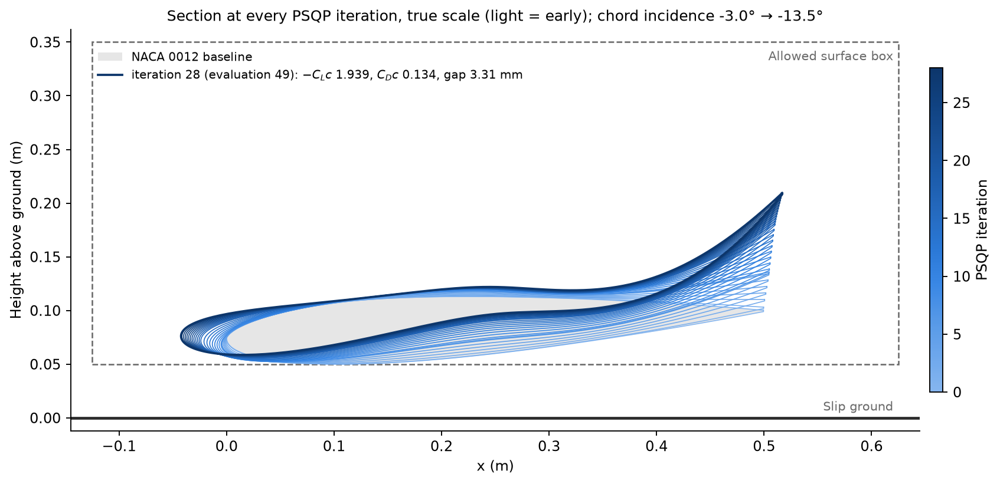
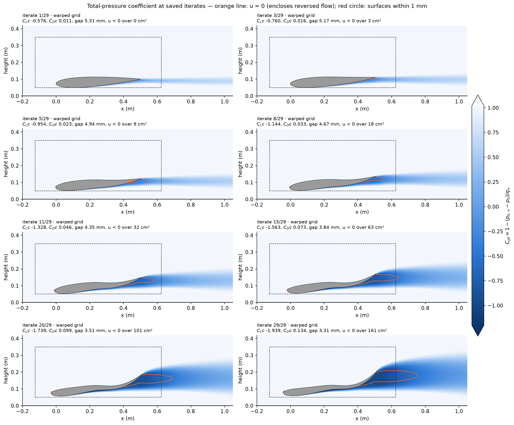
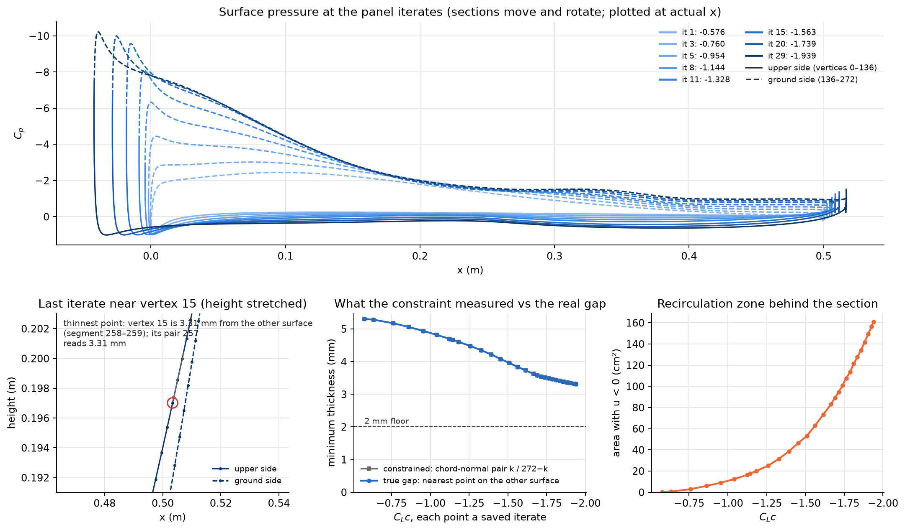

# Clean run from the NACA 0012 baseline: XMAX 1.0, true 2 mm gap, November 1

Goal: one PSQP run from the NACA 0012 baseline, with no continuation, toward the box x limits. The settings:

- **Thickness:** the new true-gap thickness floor (`--thickness-measure gap`, 2 mm).
- **Step limit:** a fixed XMAX of 1.0.
- **Drag:** the cap set to C_D·c 5 (`--drag-cap 10`) so it never binds.
- **Solver:** a 10000-cycle cap, with one NK retry before a solve counts as failed.

It ran on 64 ranks on the original overset grid, warped by IDWarp; there was no remeshing. Forces are C_L·c = L′/q∞ and C_D·c = D′/q∞.

**Result: stopped by hand after 118 min, with no constraint active.** The best design is evaluation 49 (PSQP iteration 28). The run was stopped because failed flow solves had cut progress per iteration to about a sixth of its earlier rate, not because of the geometry, the grid or a constraint. It was stopped during evaluation 52, a quarter step, after evaluations 50 (full step) and 51 (half step) had both failed. `final/` was never written; `best_feasible/` holds evaluation 49.

| | Start (evaluation 5) | Best (evaluation 49) | Limit |
|---|---:|---:|---|
| C_L·c | −0.576 | **−1.939** | — |
| C_D·c | 0.0115 | 0.134 | cap 5, never near |
| Downforce / drag | 50.2 | 14.5 | — |
| Thinnest true gap | 5.31 mm | 3.31 mm | ≥ 2 mm |
| Ground clearance | 50.0 mm | 58.7 mm | ≥ 50 mm |
| Leading / trailing edge to the box | 125 / 125 mm | 83 / 108 mm | ≥ 0 |
| Chord incidence | −3.0° | −13.5° | free |
| Chord length | 0.500 m | 0.575 m | — |
| Recirculation area (u < 0) | 0 cm² | 161 cm² | — |

Evaluation 0 is the baseline solve. Evaluations 1–4 are the derivative check before PSQP. PSQP's iteration 0 is evaluation 5.



## Findings

### 1. Failed solves, not the design, ended the run

The run had two phases, split at PSQP iteration 16 (evaluation 24):

| Phase | PSQP iterations | Wall time | C_L·c gained | Per iteration | Failed solves |
|---|---|---:|---:|---:|---|
| Full steps converge | 0 → 16 | 50 min | −1.089 | 3.1 min, −0.068 | 3 (evaluations 12, 13, 15) |
| Every full step fails | 16 → 28 | 59 min | −0.273 | 4.9 min, −0.023 | 15 of 27 evaluations (25–51) |

- **Over the whole run, 18 of the 52 solves failed.** They used 62 of the 118 min. All solves together took 98 min; adjoints and setup took the rest.
- **Each phase-2 failure cost about 170 s**: 10000 cycles plus the NK retry. The three early failures took about 6 min each.
- **A failure doesn't stop just short of the target; it stalls well above it.**
  - Phase-2 failures stall at 1–5e-6 of the initial residual, four orders of magnitude above the 1e-10 target (panel c).
  - The early failures stalled at about 1e-7.
  - Converged solves reach the target.
- **After a failure, PSQP halves the step along the same direction.** The half step then converged, every time through iteration 26 (panel d). Each iteration from 16 on therefore cost a failed full step plus a half step, for half the progress.
- **By the end, the half steps were failing too.**
  - Evaluation 48 (half step) failed, and evaluation 49 needed a quarter step.
  - Evaluations 50 and 51 repeated that pattern.
  - Progress fell to −0.011 in C_L·c per iteration, at about 7 min each.

### 2. The failed designs have steady solutions; the solver just can't reach them from a full step away

Every solve starts from the current flow state. After a failure, it is reset to the last converged one (`anchor_state` in [`run_slip_optimization.py`](../../scripts/run_slip_optimization.py)). In phase 2, the design that failed as a full step was reached one iteration later as a half step, and that time it converged:

| Failed (full step) | Converged later | Distance between them (XMAX = 1) | C_L·c, failed / converged |
|---|---|---:|---|
| 25 | 28 | 0.036 | −1.713 / −1.715 |
| 27 | 30 | 0.040 | −1.737 / −1.739 |
| 29–43 (8 cases) | 32–46 | 0.010–0.018 | match within 0.005 |
| 45 | 48 | 0.008 | −1.945 / −1.948, **failed again** |

- **What this shows:** the solver converges from a state half a step away but not from a full step away. A step of XMAX 1.0 had become larger than the distance the solver can bridge from its starting flow. It is a problem of where the solve starts, not of whether the design has a steady flow.
- **The exception:** at evaluation 48, the same design failed from half a step away. That is the first sign that the bridgeable distance is still shrinking, or that a real steady-state limit is near C_L·c ≈ −1.945. This run doesn't tell which.

### 3. The warped grid was still usable



From evaluation 25 on, ADflow repeatedly warned that symmetry faces BC9/BC10 of the background zone were "not planar" with a 180° deviation. That is a flipped cell face, and it first appeared at the same evaluation as the full-step failures. [`check_warped_cells.py`](../../scripts/check_warped_cells.py), run on every saved iterate, shows what it is:

- **Background grid:** the warp inverts background cells inside the section, at x 0.30–0.48 m. It started at 4 cells (iteration 18) and reached 75 by iteration 28. All of them are flooded, so they are never computed.
- **Computed cells:** none are inverted in either grid, and the near-body grid has no inverted cells at all.
- **Smallest computed cell, relative to the NACA grid:** 78 % in the near-body grid and 13 % in the background grid.
- **Converged solves have them too.** Every converged iterate from evaluation 28 on has inverted flooded cells, so they aren't what makes the full steps fail.

The original grid had not yet reached its limit. In the October 31 warped chains, trials started failing with negative volumes near C_L·c −2.5.

### 4. With drag free, the optimizer bought downforce with separation



- **Shape:** the leading edge moved 42 mm forward, and the aft 40 % of the section swept up into a steep ramp ending 0.21 m above the ground. Incidence went from −3.0° to −13.5°.
- **Separation:**
  - From C_L·c −0.86 on, the ground-side flow separates at x ≈ 0.38–0.40 m (Cpt figure below).
  - The bubble behind the upswept trailing edge grows steadily, from 0 to 161 cm².
  - C_D·c rose twelvefold, and downforce/drag fell from 50 to 14.5.
- **Comparison with the capped chains:**
  - The October 31 chains were drag-capped. At the same downforce (C_L·c ≈ −1.75), their C_D·c was about 0.05; this run's was 0.103 (panel f).
  - The cap had steered them onto a far more efficient path. With the cap out of reach, PSQP never paid for drag.
- **Link to the failures:** the full-step failures began once the bubble passed about 80 cm². Bubble size alone doesn't explain them, though. The remeshed October 31 chain converged with bubbles up to 613 cm² at C_L·c −3.3, on a different section and a fresh grid.



### 5. The true-gap constraint behaves as intended, but was never tested here

The true gap and the old chord-normal pair measure agree at every iterate (middle panel below), so no pinch formed. The thinnest point is near the trailing edge (vertex 15). The gap fell steadily from 5.31 to 3.31 mm, but the floor never became active. [`gap_constraint_test_20261101`](../gap_constraint_test_20261101) is still the only run where the gap constraint is active.



## What would help next

1. **Recover a failed step in design space instead of reporting it.**
   - On a failed solve, first converge the midpoint geometry, then solve the trial from that state.
   - Finding 2 says this converges the same design PSQP asked for, so the optimizer keeps its XMAX 1.0 step and never sees a failure.
   - That is about 130 s of solves per full step, against 240 s now (a failed full step plus a half step) for half the progress.
   - Lowering XMAX to 0.5 for this stretch would do much the same with no code change, but it gives up the fixed XMAX 1.0.
2. **Find out whether C_L·c ≈ −1.945 is a real limit.** Re-solve evaluation 48's design for much longer, starting from evaluation 49's state, which is a quarter step away. If it still stalls near 1e-6, the steady problem may have no solution there.
3. **Decide what drag is allowed to cost.** With no effective cap, the path runs through heavily separated flow at moderate downforce. A cap, or a downforce/drag objective, would keep the run on the efficient branch the October 31 chains found.

## Files and reproduction

- **`command.txt`, `settings.json`:** the exact run and its resolved settings.
- **`history.jsonl`, `gradients.jsonl`, `PSQP.out`, `run.log`:** every evaluation, adjoint, optimizer line and solver message.
- **`iterates/eval_NNN/`:** each PSQP iterate's design, result, surface and slice. Volume CGNS files are kept locally (git-ignored).
- **`run_summary.json`, `iterate_flows_clean_xmax1.0.json`:** the numbers behind the figures.

```
python scripts/plot_iterate_flows.py --out optimizations/clean_xmax1.0_gap2mm_20261101 \
    --name clean_xmax1.0 optimizations/clean_xmax1.0_gap2mm_20261101
python scripts/plot_clean_run.py optimizations/clean_xmax1.0_gap2mm_20261101
python scripts/check_warped_cells.py optimizations/clean_xmax1.0_gap2mm_20261101/iterates/eval_049/flow_000_vol.cgns
```
