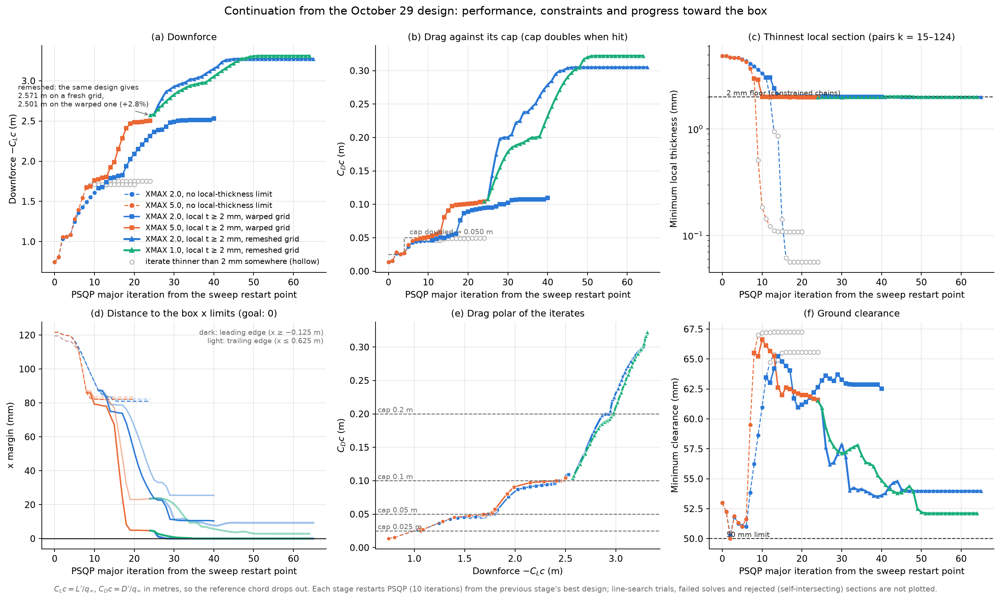

# PSQP continuation toward the box x limits, October 31 – November 1

Goal: keep optimizing from the October 29 final design until the airfoil reaches the box x limits (−0.125 ≤ x ≤ 0.625 m), doubling the drag cap whenever it becomes active. Everything ran on a 64-core EPYC 7601 desktop, two chains at a time on 32 MPI ranks each, with every stage a fresh 10-iteration PSQP restart from the previous stage's best design ([`scripts/run_continuation.py`](../../scripts/run_continuation.py)). Forces are C_L·c = L′/q∞ and C_D·c = D′/q∞ in metres; at 200 km/h, 1 m of C_L·c is about 1,890 N/m of downforce.

**Result: the leading edge reached the box limit, and the optimizer kept going along it.** On a freshly generated grid, the leading edge first reached x = −0.125 m at C_L·c −2.783 m (C_D·c 0.175 m). Both remeshed chains then rode the limit with the leading-edge x constraint active. The XMAX 1.0 chain ended at **C_L·c −3.312 m, C_D·c 0.322 m** (about 6,260 N/m, 4.45× the restart point), with the trailing edge 2.9 mm from its own limit. A re-solve of that design with fully rebuilt overset connectivity agrees to 0.06 % in lift and 0.03 % in drag. See [Final state](#final-state).



## How the campaign went

| Phase | Chains | What stopped it | Best C_L·c (m) | Lead / trail margin (mm) |
|---|---|---|---:|---|
| 1. No local-thickness limit, warped grid | `continuation_xmax{2.0,5.0}` | the aft section pinched shut (0.06–0.11 mm) and folded through itself | −1.754 (pinched) | 81 / 82 |
| 2. 2 mm local-thickness floor, warped grid | `continuation_tmin2mm_xmax{2.0,5.0}` | the warped mesh inverted cells (negative volumes) for any further step | −2.501 (warped grid) | 4.7 / 23.5 |
| 3. 2 mm floor, remeshed grid | `continuation_remesh2_xmax{2.0,1.0}` | reached the leading-edge limit, then stalled 2.9 mm from the trailing-edge limit on surfaces crossing between unpaired vertices (finding 9) | −3.312 | 0.0 / 2.9 |

The drag cap was doubled four times, as specified: C_D·c 0.025 → 0.05 → 0.1 → 0.2 → 0.4 m. The final design uses 81 % of the last cap.

### Phase 1: no local-thickness limit

| Chain | Stage | Cap C_D·c (m) | Best C_L·c (m) | Gain | Lead / trail (mm) | Rejected sections |
|---|---|---:|---:|---:|---|---:|
| 2.0 | 00 | 0.025 | −1.0624 | +42.7 % | 120 / 116 | 0 |
| 2.0 | 01 | 0.050 | −1.7041 | +60.4 % | 84 / 84 | 3 |
| 2.0 | 02–03 | 0.050 | −1.7540 | +2.9 % | 81 / 82 | 180 |
| 5.0 | 00 | 0.025 | −1.0633 | +42.8 % | 120 / 116 | 0 |
| 5.0 | 01–02 | 0.050 | −1.7114 | +61 % | 82 / 84 | 197 |

Both chains stalled about 82 mm short of each limit. The problem bounded only the *maximum* section thickness, so PSQP found its last downforce by collapsing the aft section at x/c ≈ 0.67 into a sheet 0.06–0.11 mm thick. After that its steps produced self-intersecting surfaces: about 380 trials were rejected, and all 18 replayed ones crossed between vertices 46–55 and their mirrors. The best designs that keep 2 mm everywhere were within 5 % of the pinched optima ([section figure](plots/section_comparison.png)).

### Phase 2: 2 mm local-thickness floor (`--min-local-thickness 0.002`)

The new constraint measures vertex k against its mirror 272−k, normal to the current chord, for k = 15–124. That covers everything except the leading edge and the last 2–3 % of chord. It is signed, so it goes negative where the surfaces cross; its derivatives use complex step through pyGeo, with geometry-check errors of 1e-10 to 1e-12. Both chains restarted from their best pre-pinch iterate (−1.663 and −1.675 m).

| Chain | Stage | Cap C_D·c (m) | Best C_L·c (m) | Gain | Lead / trail (mm) | Failed evaluations |
|---|---|---:|---:|---:|---|---:|
| 2.0 | 00 | 0.050 | −1.7890 | +7.6 % | 75 / 79 | 0 |
| 2.0 | 01 | 0.100 | −1.8157 | +1.5 % | 74 / 79 | 3 |
| 2.0 | 02 | 0.100 | −2.3868 | +31.5 % | 23 / 33 | 1 |
| 2.0 | 03 | 0.100 | −2.4798 | +3.9 % | 11 / 26 | 1 |
| 2.0 | 04–05 | 0.200 | −2.5318 | +2 % | 10 / 26 | 101 |
| 5.0 | 00 | 0.050 | −1.7636 | +5.3 % | 79 / 82 | 0 |
| 5.0 | 01 | 0.100 | −1.7936 | +1.7 % | 78 / 82 | 6 |
| 5.0 | 02 | 0.100 | −2.4678 | +37.6 % | 5.0 / 23 | 3 |
| 5.0 | 03 | 0.200 | −2.5013 | +1.4 % | 4.7 / 23 | 33 |

The floor became active at once and stayed exactly at 2.00 mm. Stages 01 ran under the old solver settings and stalled on most large steps; stages 02 onward used the faster settings below, and progress resumed. The stages then ended on the mesh. Trials beyond about 10 mm (2.0) and 4.7 mm (5.0) from the leading-edge limit failed instantly with "negative volumes present in grid".

### Phase 3: remeshed grid

[`scripts/remesh_design.py`](../../scripts/remesh_design.py) regrows the near-field block with pyHyp from a design's actual 289-vertex surface, with the original case's settings (81 layers, 2 µm first cell, 25 mm march, `cMax` 1 and 30 smoothing iterations here), and rebuilds the identical background. The FFD lattice is written in its deformed position, so the design variables restart at zero from the current shape, with the original incidence pivot ([`--baseline`](../../scripts/run_slip_optimization.py)). The 5.0 chain's stage-03 evaluation 34 (4.7 mm from the limit) was remeshed into a grid with no inverted cells and no negative corner Jacobians. From there, two chains (XMAX 2.0 and 1.0) ran on the fresh grid.

## Findings

1. **The warped grid under-predicted downforce, increasingly so.** Re-solving the same design on a fresh grid gave 1.3 % more downforce at 45 % chord growth (−2.5657 against −2.5318 m) and 2.8 % more at the remeshed design (−2.5723 against −2.5013 m). Drag agreed within 0.5 %. The warped-grid history is a fair guide, but quote fresh-grid numbers.

2. **The adjoint is exact on both grids, except at exactly zero mesh deformation.** On the warped grid at −2.53 m, the incidence derivatives match central differences to 0.03 % (lift) and 0.00 % (drag). Every fresh grid failed the optimizer's built-in check at its own baseline (lift 42 % off, drag 5 %), whatever the pyHyp settings, because the lift response has a kink there: +0.0008 and −0.0013 in C_L for ±0.01°. Moving the check point by 0.02° gives agreement to 0.05 % and 0.00 %. The kink comes from the IDWarp response at zero surface displacement. A remeshed chain therefore starts 0.02° off its baseline and is gated by that offset check ([`scripts/check_derivatives_at.py`](../../scripts/check_derivatives_at.py), results in `../derivative_check_20261031/`).

3. **The warp limit was two separate problems.** Most instant failures came from one or two very large far-field background cells (x ≈ 6.2 m, y ≈ 1 m) inverted by IDWarp's far-field approximation, at `errTol` 5e-4. With `--warp-err-tol 1e-5` (or exact evaluation) those designs warp cleanly; that same tolerance change alone moves C_L by about 0.5 % at these deformations. The rest were real: near-field cells just above the upswept trailing edge sheared inside out once the leading edge was pushed within ~10 mm (2.0) or ~4.7 mm (5.0) of the limit. Only remeshing fixed those.

4. **An earlier Newton–Krylov handover made each iteration 2.7–3× faster and also more robust** ([solver test](../solver_tolerance_test_20261031/README.md)). With `--nk-switch-tol 1e-6` (instead of `ank_deep`'s 1e-8), flow solves dropped from 206–255 s to 45–55 s, with lift and drag unchanged to 1e-7 and gradients to 3e-6. Designs that stalled under the old setting converged under the new one. `--nk-fallback-tol 1e-8` re-solves a stalled design once with the old handover; that rescued solver-type stalls in testing, but on oversized steps both settings fail and the retry only costs time.

5. **Drag tracks downforce almost linearly once the section is fully cambered** ([drag polar, panel e](plots/performance_history.png)). From −2.0 to −3.31 m, C_D·c rose from 0.09 to 0.32 m, so −L/D fell from about 22 to 10. Each cap doubling bought a further leg of downforce, and drag became active again within a few iterations each time.

6. **The design is a strongly cambered, reflexed, nose-down section** ([control points: remeshed XMAX 2.0](plots/control_point_history_remesh2_xmax2.0.png), [1.0](plots/control_point_history_remesh2_xmax1.0.png), [warped 2 mm XMAX 2.0](plots/control_point_history_tmin2mm_xmax2.0.png)). In the final design the chord has grown from 0.510 to 0.774 m and the chord incidence is −15.3° (from −3.6°). The trailing edge has risen to y = 0.28 m and moved to 2.9 mm from its limit. The leading edge moved forward 121 mm onto its limit, and the aft section thinned to the 2 mm floor at x/c ≈ 0.72. Minimum clearance stayed 52–67 mm against the 50 mm limit.

7. **Step size: XMAX 1–2 is the useful range; 5 is too large.** Lift followed the adjoint prediction to 90–98 % and drag to 103–117 % at step 2; XMAX 5.0 steps failed half the time and gained nothing. On the remeshed grid, XMAX 2.0 reached the leading-edge limit first. XMAX 1.0 went further (−3.31 against −3.27 m) and had no failed solves, while 2.0's larger trials stalled the flow solver 10 times. The two chains ended within 1.2 % of each other in downforce, on similar −15° sections. Near the limits, the smaller step paid off.

8. **Two optimizer bugs were fixed in `run_slip_optimization.py`.** Rejected (self-intersecting) trials no longer trigger a stale adjoint solve; one stalled stage had run 131 adjoints for 10 iterates. The chain driver now picks restart designs with the optimizer's own tolerances, takes the 2 mm floor to within 5 µm (PSQP overshoots its linearised floor by 1–2 µm), and restarts from the chosen iterate's own saved flow.

9. **The 2 mm floor stops protecting the section at extreme camber.** The final stall is again self-intersection. This time the crossing is between vertices 57/58 and 212, which are not mirror pairs (212 pairs with 60), while every measured pair still reads ≥ 2 mm. At −15° incidence, with the trailing edge at y = 0.28 m, the upper and lower surfaces slide along the chord relative to each other. Thickness normal to the overall chord, between vertices that started at the same station, then no longer tracks the true local thickness. A thickness measured normal to the local camber line (or a minimum distance between the two surfaces) would close the gap. That is a formulation change, left as a decision.

10. **Frozen overset connectivity costs nothing on a fresh grid.** Rebuilding the connectivity for the final design moves lift by 0.06 % and drag by 0.03 % (see Final state). The open accuracy questions are grid resolution and steadiness, not the overset treatment.


## Final state

| Chain (fresh grid) | Status | Best C_L·c (m) | C_D·c (m) | −L/D | Lead / trail margin (mm) | Chord (m) | Incidence | Clearance (mm) | Top of section (m) |
|---|---|---:|---:|---:|---|---:|---:|---:|---:|
| remesh2, XMAX 1.0 | stopped (stalled) | **−3.3118** | 0.3223 | 10.3 | **0.0** / 2.9 | 0.774 | −15.3° | 52.1 | 0.280 |
| remesh2, XMAX 2.0 | stopped (stalled) | −3.2743 | 0.3052 | 10.7 | **0.0** / 9.3 | 0.766 | −14.9° | 54.0 | 0.275 |

Full-connectivity re-solve of the XMAX 1.0 final design ([`../validation_20261101/remesh2_xmax1.0_final_fullconn`](../validation_20261101/remesh2_xmax1.0_final_fullconn)): C_L·c −3.3097 m, C_D·c 0.3222 m, residual drop 4.6e-11, feasible against every constraint. The leading edge is at −0.124999 m and the local thickness 2.005 mm.

The first design on the leading-edge limit (remesh2 XMAX 2.0, stage 00) was C_L·c −2.8933 m at C_D·c 0.200 m (−L/D 14.5). Every gain past it was paid for in drag at a falling L/D. Panel (e) of the figure shows that trade, which matters if the drag cap is a real budget rather than a formality.

## Caveats

- This is still one grid family (88,548 cells, slip ground, first-order turbulence, frozen overset connectivity within each run), now regenerated around the final shape but not refined. The solver study put that grid at 1.4–3.7 % error on the NACA case. The final design has an upswept trailing edge 0.17 m above the ground and a 2 mm-thick aft section. Before quoting the numbers, re-solve the final design on a refined grid with full overset connectivity.
- Steady RANS. The final design is pitched −15° nose-down, with −L/D ≈ 10 and very strong aft camber. Check its flow for trailing-edge separation before trusting it, ideally with an unsteady (time-accurate) solve; a steady solution may not represent it, even though this one converged to 1e-11.
- The warped-grid phases' absolute values are 1–3 % low (finding 1). Their trends, and every comparison within one grid, are consistent.
- Stage 00 of the first chains also stands in for the XMAX sweep's 2.0 and 5.0 entries, but it is not the same run (32 ranks, ended on the drag cap after four evaluations).

## Reproduction

```sh
source ~/software/mdolab/env.sh   # conda env mdolab + MACH-Aero (and pyHyp, cgnsutilities) built from source
# phase 2 (phase 1 is the same without --min-local-thickness and the solver flags)
python scripts/run_continuation.py --chain optimizations/continuation_tmin2mm_xmax5.0_20261031 \
    --start-design optimizations/continuation_tmin2mm_xmax5.0_20261031/start_design.json \
    --start-flow optimizations/continuation_xmax5.0_20261031/stage_01/best_feasible/flow_000_vol.cgns \
    --xmax 5.0 --maxit 10 --drag-cap 0.1 --min-local-thickness 0.002 --max-stages 100 --save-iterate-flows \
    --nk-switch-tol 1e-6 --nk-fallback-tol 1e-8 --warp-err-tol 1e-5 --ncycles 60000 --ranks 32 --first-core 32
# phase 3: remesh, check off the zero point, run
R=optimizations/remesh_20261031/r6_from_tmin2mm_xmax5.0_stage03
python scripts/remesh_design.py --design $R/source_design.json --out $R --hyp-options '{"cMax": 1.0, "volSmoothIter": 30}'
mpirun -np 32 python scripts/check_derivatives_at.py --at $R/offset_design.json --step-deg 0.01 --baseline $R/baseline.json ...
python scripts/run_continuation.py --chain optimizations/continuation_remesh2_xmax2.0_20261031 \
    --start-design $R/offset_design.json --start-flow none --checks <offset check json> --source-dir $R/source \
    --baseline $R/baseline.json --xmax 2.0 --drag-cap 0.4 --min-local-thickness 0.002 ... (as above)
python scripts/plot_continuation.py --out optimizations/continuation_summary_20261031 \
    optimizations/continuation_{,tmin2mm_}xmax{2.0,5.0}_20261031 optimizations/continuation_remesh2_xmax{2.0,1.0}_20261031
```

The exact command of every stage is in its `command.txt`. `continuation_summary.json` lists every plotted iterate. Flow files are not committed. Runs set aside during the night (no-fix stage 05, the remesh1 attempt, stages that hit the old 20,000-cycle limit) are in the session scratch folder, not in the repo.
