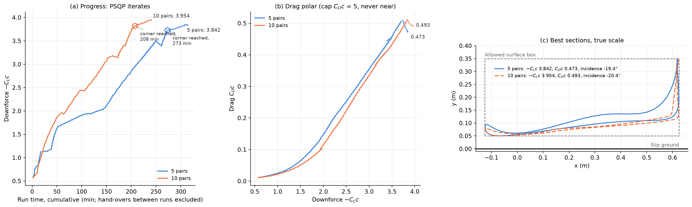
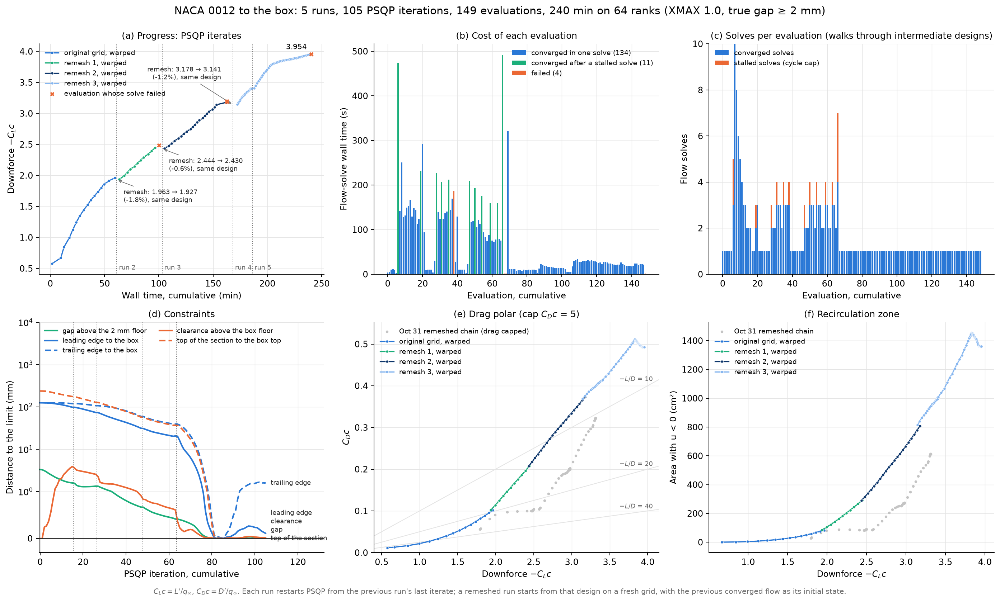
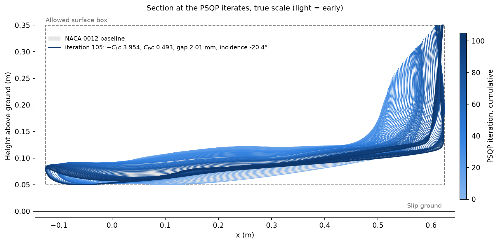

# 10 FFD pairs: from NACA 0012 to the corner of the box, November 1–2

Goal: repeat the 5-pair push to the corner of the box ([`box_summary_20261101`](../box_summary_20261101)) with 10 upper/lower FFD pairs instead of 5. That gives 41 design variables instead of 21. The settings were unchanged:
- XMAX 1.0;
- the true-gap floor of 2 mm;
- a drag cap high enough never to bind (C_D·c 5);
- a 10000-cycle cap.

One thing differed: the walk through intermediate designs after a stalled solve was on from the first run. The 5-pair chain gained it only after its clean run.

Everything ran on 64 ranks. Forces are C_L·c = L′/q∞ and C_D·c = D′/q∞.

**Result: with 10 pairs the section reached the corner sooner and went further.**
- **Corner reached:** every box limit came within 1 mm and the gap within 0.1 mm of its floor at 208 min of run time, PSQP iteration 79 (C_L·c −3.819). With 5 pairs that took 273 min and 92 iterations, and came at −3.728.
- **Best design:** evaluation 43 of the last run, at C_L·c **−3.954**. That is 2.9% more downforce than the 5-pair best (−3.842), for 4.1% more drag (C_D·c 0.493 against 0.473). It is fully converged (residual 7e-11 of the initial) and feasible.
- **Why the chain stopped:** PSQP was still gaining about 0.005 per iteration. It stopped because the warped grid inverted cells, and a fresh pyHyp grid could not be grown around the trailing edge, which was by then a 4.7° wedge pointing straight up (finding 4).

| Limit | 10 pairs, best | 5 pairs, best | Limit |
|---|---:|---:|---:|
| Leading edge x | −0.12489 m | −0.1239 m | ≥ −0.125 m |
| Trailing edge x | 0.62342 m | 0.6237 m | ≤ 0.625 m |
| Top of the section | 0.35000 m | 0.35000 m | ≤ 0.35 m |
| Ground clearance | 50.0 mm | 50.2 mm | ≥ 50 mm |
| Thinnest true gap | 2.01 mm | 2.05 mm | ≥ 2 mm |
| Chord, incidence | 0.795 m, −20.4° | 0.786 m, −19.4° | free |
| Downforce / drag | 8.0 | 8.1 | — |
| Recirculation area (u < 0) | 1359 cm² | 1232 cm² | — |







## How it went

| Run | Grid | PSQP iterations | Evaluations | Solves (stalled) | Failed evaluations | Run time | C_L·c |
|---|---|---:|---:|---:|---:|---:|---|
| [original grid](../ffd10_xmax1.0_gap2mm_20261101) | original, warped | 16 | 21 | 64 (3) | 0 | 60 min | −0.576 → −1.963 |
| [remesh 1](../ffd10_remesh1_xmax1.0_gap2mm_20261101) | remeshed at −1.963 | 11 | 19 | 41 (4) | 1 (negative volumes) | 41 min | −1.927 → −2.470 |
| [remesh 2](../ffd10_remesh2_xmax1.0_gap2mm_20261101) | remeshed at −2.444 | 21 | 29 | 69 (8) | 2 (negative volumes) | 62 min | −2.430 → −3.178 |
| [remesh 3](../ffd10_remesh3_xmax1.0_gap2mm_20261101) | remeshed at −3.178 | 16 | 35 | 35 (0) | 0 | 23 min | −3.141 → −3.403 |
| [remesh 3, PSQP restarted](../ffd10_remesh3b_xmax1.0_gap2mm_20261101) | as remesh 3 | 42 | 45 | 45 (0) | 1 (negative volumes) | 54 min | −3.403 → −3.954 |

That is 105 PSQP iterations and 240 min of run time. Clock time was 19:43–00:27: 4 h 44 min, including the hand-overs, two failed derivative checks and a step-size study on grid 3. The remesh-3 run's evaluations include 17 for its derivative check.

1. **Original grid** (19:43–20:52): to C_L·c −1.96 in 60 min, without one failed evaluation. Then a step stalled twice in a row on half-steps, the sign that the warped grid was wearing out, so the grid was remeshed at iterate 20.
2. **Remesh 1:**
   - The fresh grid gave 1.8% less downforce at the same design.
   - The derivative check passed (0.3%).
   - Full steps stalled every few evaluations, and the walk recovered each one.
   - At evaluation 17 the warp produced negative volumes after only 11 iterations, so the grid was remeshed again.
3. **Remesh 2:** behaved like remesh 1.
   - The walk shortened its steps after each stall, then lengthened them by 1.25× per clean evaluation, so a full step stalled again every 3–4 evaluations.
   - Evaluation 26 needed 7 solves, 3 of them stalled, down to steps 0.11 long. The next trial step inverted cells.
   - The grid was remeshed at iterate 26 (C_L·c −3.178).
4. **Remesh 3:** the derivative check failed twice before it passed; see finding 5. After that, every step converged in one solve. PSQP then stopped by itself after 16 iterations with exit code −11, which pyoptsparse reports as "Optimization failed". Its reported gradient norm jumped from 0.01 to 6e14, but the aerodynamic and geometric gradients at that design were normal.
5. **The same grid, PSQP restarted** from iterate 33:
   - PSQP's steps immediately gained three times as much as just before its exit.
   - It reached the corner at evaluation 17 and kept improving along the limits, cutting C_D·c from 0.511 to 0.493.
   - At evaluation 44 the warp inverted cells. A fresh grid at iterate 43 inverted 13 cells at the trailing edge, and 9 other pyHyp settings did no better (finding 4).

## Findings

1. **10 pairs was faster than 5, not slower.** I had estimated about 30% more time. That estimate assumed both runs would end at the same shape, so the iteration count would follow the distance in design space.
   - What happened instead: from C_L·c −2.0 to −3.8, the 10-pair chain needed 59 PSQP iterations and 134 min, against 87 and 162 min for 5 pairs.
   - Most steps run at the XMAX limit. With more variables the gradient is larger, so a step of the same length buys more downforce.
   - The cost of each iteration stayed nearly the same: 2.3 min against 1.9 min. The difference is stalled solves and derivative checks.
   - Before −2.0 the chains aren't comparable: the 5-pair clean run had no walk and lost 62 of its 118 min to 18 failed solves.
2. **10-pair designs wear out a grid faster.** The warped grids lasted 11, 21 and 58 iterations before inverting cells; the 5-pair chain's remeshed grids lasted 49 each. Remeshing is quick (10 s, then a 1.5–5.5 min warm start from the old grid's flow), so this cost little.
3. **Each fresh grid gave a little less downforce** at the same design: −1.8%, −0.6% and −1.2%. On the 5-pair chain the changes were +0.6% and −3.0%. The warped grids may lean slightly towards more downforce, but there has been no grid-convergence study.
4. **The trailing edge is what stopped the run.**
   - The gap floor applies only up to 2–3% of chord from the trailing edge (vertex pairs 15–124), so nothing in the problem limits the trailing-edge angle.
   - In the corner, PSQP thinned the trailing edge into a wedge pointing straight up: 4.7° on the 10-pair best.
   - The 5-pair best is sharper still, at 2.6°. Its grid had been made earlier, around a 7.5° wedge, and the warp carried it to the end, so that chain never needed a fresh grid in the corner.
   - The 10-pair chain did. pyHyp could not grow a valid first layer around the 4.7° wedge with any of the 10 settings tried (smoothing, `cMax`, constant-spacing first layers). The warp failed at evaluation 44, consistent with the same cause; where its inverted cells were was not checked.
   - Going further needs a change to the problem, for example a minimum trailing-edge angle or the gap floor extended to the trailing edge.
5. **The incidence-only derivative check was too weak; the new check confirms the adjoint.**
   - At C_L·c −3.14 the downforce barely changes with incidence (0.0017 per degree). So an absolute error of 3.9e-4 per degree, about twice that on earlier grids, read as 23% and failed the check.
   - The check now also tests each function along its own adjoint gradient in the shape variables.
   - A step-size study at that design ([`derivative_step_study`](../ffd10_remesh3_xmax1.0_gap2mm_20261101/derivative_step_study)), with every solve restarted from the same flow, showed:
     - central differences match the adjoint to 0.4% (objective) and 0.1% (drag) at 0.03 mm of control-point motion;
     - at 0.1 mm and more, the second differences reach 20–40% of the first, so the converged flow responds non-smoothly on that scale;
     - re-solving the base design from a different starting flow changes the objective by only 6e-7 of itself, so this is not solver path dependence.
   - The check therefore takes the best of 0.01, 0.03 and 0.1 mm steps, and the incidence part also passes when its error is under 1% of the whole scaled gradient.
   - The adjoint gradients are accurate. The roughness of the response, at a hundredth of PSQP's steps, may be what upsets its line search near an optimum: the 5-pair chain's stalled line search and this run's exit −11. That is a hypothesis.
6. **The extra freedom went into the aft section, not into drag.** At equal downforce, the 10-pair chain had 22% less drag at C_L·c −2.15 but only 5% less from −3.0 on. Its best has slightly more drag and more reversed flow (1359 against 1232 cm²) than the 5-pair best. The same caveat applies as before: this is steady RANS on a bluff, heavily separated section, so the final numbers need an unsteady (URANS) check.

## Code changes made during the run

- `run_slip_optimization.py`:
  - **Walk fix.** After a stall, the walk halves the step that was actually tried. Before, when a step was clipped at the target design, halving the nominal step could retry the same design; this happened once and cost one solve.
  - **Derivative check.** The shape-direction check described in finding 5 is added, and the incidence part also accepts an absolute error under 1% of the scaled gradient.
- `remesh_design.py` takes the number of FFD stations from the design file instead of assuming 5.
- `plot_run_chain.py` ignores the summary line PSQP writes when it exits by itself.
- `plot_pairs_comparison.py` is new: the 5-against-10 figure above.

## Reproduction

Each run's `command.txt` records its command, its grid and initial flow, and why it was stopped. The remeshes are in [`../remesh_20261101`](../remesh_20261101) (`r1`–`r3_from_ffd10_*`). The failed fourth one is kept with a `FAILED.txt`.

```
python scripts/plot_iterate_flows.py --out optimizations/<run> --name <run without _gap2mm_20261101> optimizations/<run>
python scripts/plot_run_chain.py --out optimizations/ffd10_summary_20261101 \
    optimizations/ffd10_xmax1.0_gap2mm_20261101 optimizations/ffd10_remesh1_xmax1.0_gap2mm_20261101 \
    optimizations/ffd10_remesh2_xmax1.0_gap2mm_20261101 optimizations/ffd10_remesh3_xmax1.0_gap2mm_20261101 \
    optimizations/ffd10_remesh3b_xmax1.0_gap2mm_20261101
python scripts/plot_pairs_comparison.py --out optimizations/ffd10_summary_20261101 \
    --chain '5 pairs' optimizations/box_summary_20261101 optimizations/box_remesh2_xmax1.0_gap2mm_20261101/best_feasible/surface_geometry.csv \
    --chain '10 pairs' optimizations/ffd10_summary_20261101 optimizations/ffd10_remesh3b_xmax1.0_gap2mm_20261101/best_feasible/surface_geometry.csv
```
