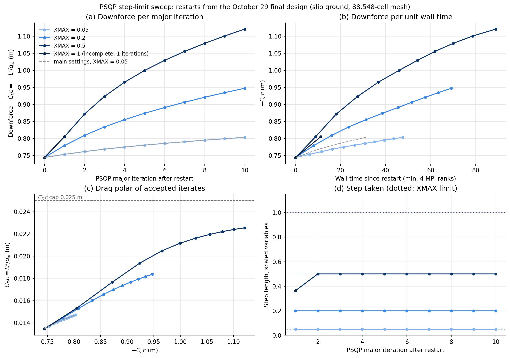

# PSQP step-limit (XMAX) sweep with `ank_deep`, October 31

Four 10-iteration PSQP restarts from the October 29 final design, differing only in the step limit `XMAX` (scaled variables: incidence in degrees, shape displacements in cm). All use `--solver ank_deep`, the flow-solver variant that converges steps the main settings stall on (see [the first sweep](../xmax_sweep_20261031/README.md)). Forces are C_L·c = L′/q∞ and C_D·c = D′/q∞ in metres, so the reference chord drops out. Sequential on 4 MPI ranks of this laptop.



| XMAX | Final C_L·c (m) | Gain over restart | Final C_D·c (m) | Steps at limit | Chord (m) | Min clearance (m) | Max thickness (m) | Wall (min) |
|---|---:|---:|---:|---|---:|---:|---:|---:|
| 0.05 (main settings, reference) | −0.8036 | +7.9 % | 0.01471 | 10/10 | 0.5112 | 0.0529 | 0.0561 | 31.3 |
| 0.05 | −0.8036 | +7.9 % | 0.01471 | 10/10 | 0.5112 | 0.0529 | 0.0561 | 47.6 |
| 0.2 | −0.9475 | +27.3 % | 0.01837 | 10/10 | 0.5156 | 0.0530 | 0.0541 | 69.2 |
| 0.5 | −1.1211 | +50.6 % | 0.02255 | 9/10 | 0.5253 | 0.0544 | 0.0496 | 88.9 |
| 1.0 | *(pending)* | | | | | | | |

Restart point: C_L·c −0.7446 m, C_D·c 0.01346 m. Limits: C_D·c ≤ 0.025 m, clearance ≥ 0.05 m, max thickness ≥ 0.03 m, surface inside −0.125 ≤ x ≤ 0.625 m. Full table in `xmax_sweep_summary.txt`.

## Findings

1. **The step limit, not a constraint, bounds every run.** Each accepted step is exactly `XMAX` long, except the first step of the 0.5 and 1.0 runs, which PSQP cut to 0.364 against the linearised surface bounds (both runs therefore share an identical first design). No constraint became active in any run. All four end on the iteration limit, with PSQP's gradient norm at 0.07–0.09 against a 1e-4 target. These are not converged optima.

2. **Larger steps win per iteration and per unit wall time**, despite slower flow solves. After ten iterations: 0.05 → −0.80 m, 0.2 → −0.95 m, 0.5 → −1.12 m. Per flow solve, `ank_deep` costs 120–200 s at 0.05, 220–330 s at 0.2, 350–435 s at 0.5, and 480–560 s at 1.0, so the per-iteration cost rises roughly 2.5× from 0.05 to 0.5 while the gain per iteration rises 6×. Panel (b) of the figure shows the result: at 70 minutes the 0.2 run has −0.95 m and the 0.5 run −1.08 m, against −0.80 m for 0.05 after 48.

3. **The solver's cost on healthy steps is 1.5× per iteration.** The `ank_deep` 0.05 run reproduces the main-settings 0.05 run to five decimals in C_L·c at every iterate, in 47.6 min instead of 31.3. The flow solves are 3× slower (152 s mean against 50 s) because `ank_deep` keeps the segregated ANK phase going to 1e-8 before handing to Newton–Krylov, which on a small step is already in its basin at 1e-4; the ~130 s of adjoints per iteration are the same either way and dilute the penalty. `NKSwitchTol` is therefore step-size dependent, and an intermediate value (1e-6) is the obvious thing to try next. The solver was held fixed across this sweep on purpose.

4. **Nonlinearity shows up at 0.5.** The first step's gain, as a fraction of what the gradient predicts linearly: 97 % at 0.2, 68 % at 0.5. Later steps, with PSQP's curvature estimate, are better directed (the 1.0 run's second step delivered 94 % of twice the 0.5 run's second step). Within each run the gain per step shrinks steadily (0.5 run: −0.066 → −0.022 m) with the step still at the limit and nothing active: that is curvature of lift against design, not a wall.

5. **Clearance is managed, not hit.** In the 0.5 run the minimum clearance bottomed at 0.0517 m at iteration 3 and then rose to 0.0544 m: the optimizer takes nose-down rotation (−3.6° → beyond −5.6°), which drops the trailing edge, and compensates by lifting the trailing-edge control points. Drag reached 90 % of the cap by the end of the 0.5 run with its per-step increment slowing; the cap did not activate.

6. **Physically**, the 0.5 run reaches C_L·c −1.121 m, about 2,120 N/m of downforce at 200 km/h: +51 % over the restart point and +95 % over the October 29 NACA 0012 baseline, in ten iterations and 89 minutes. The chord grows 5 % (0.510 → 0.525 m) and the thickest section thins to 0.050 m, well above the 0.03 m floor.

## Caveats

- Single mesh (the partner's 88,548-cell L2 grid, which the solver study put at 1.4–3.7 % error in C_L and C_D), slip ground, first-order turbulence, and frozen overset connectivity throughout each run. Every final design should get the full-connectivity re-solve the partner used, and the leading candidate an L1.5 solve, before any number is quoted.
- The mesh is warped from the October 29 geometry; the chord has grown 5 % and the incidence has swung 2°. Past about 10 % the near-field grid should be rebuilt rather than warped further.
- The 1.0 run's solve times grow with the step (start residuals 2.6e3 → 9.1e3), so its wall time per iteration is about 12 minutes; see its row above for how far it got inside the 150-minute cap.

## Recommendation

For the next long run: `XMAX = 0.5` with `ank_deep`, from the 0.5 run's final design, with the connectivity rebuilt first. Then, separately, a short `NKSwitchTol = 1e-6` comparison on 0.5 steps to see how much of the solver overhead can be recovered without reintroducing the stall.

## Reproduction

```sh
# inside the container, aero588_project mounted at /project
CHECKS=/project/optimizations/xmax_sweep_20261031/failed_ncycles4000_xmax_0.05/source/aerodynamic_derivative_check.json \
SOLVER=ank_deep SWEEP_NAME=xmax_sweep_ank_deep_20261031 NCYCLES=20000 TIMEOUT=150m \
bash /project/scripts/run_xmax_sweep.sh 10 0.05 0.2 0.5 1.0
python scripts/plot_xmax_sweep.py --sweep optimizations/xmax_sweep_ank_deep_20261031 --reference optimizations/xmax_sweep_20261031
```

Flow solutions (`*.cgns`, `*.plt`), `optimization.hst` and `evaluations/` stay local and are not committed.
