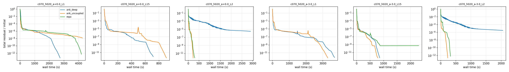
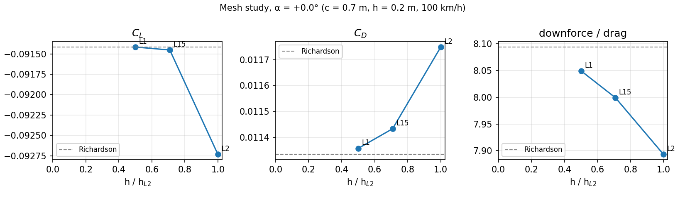
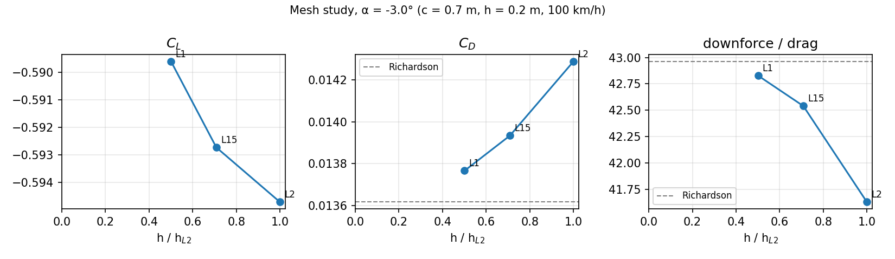
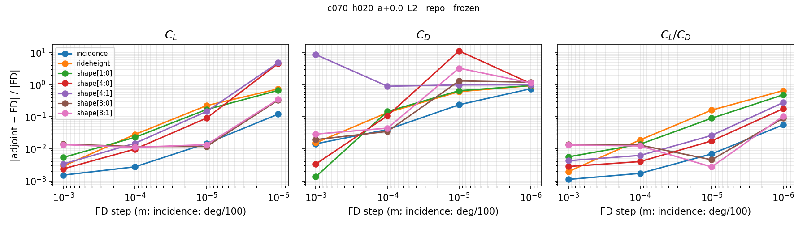

# Solver, mesh and derivative studies of the design case

**Design case.** c = 0.70 m, 100 km/h, 0.20 m clearance (h/c = 0.286), M = 0.0816, Re = 1.33 × 10⁶.
It uses the repo's boundary conditions and sign convention (`scripts/run_ground_case.py`),
fully turbulent SA RANS, at incidences α = 0 and −3°. How the shape is parameterized and
optimized is in [`../docs/shape_control_and_optimization.md`](../docs/shape_control_and_optimization.md).
The [FFD explorer](../docs/ffd_explorer.html) is an interactive version of that set-up.

Status 2026-10-25: the solver test, mesh study and adjoint check are done, including the
follow-ups (a jump-free FD check and an NK-tuned solver variant).

## Key learnings

1. **Sign convention verified.** α = −3° puts the LE below the TE (chord-line angle +3.0°)
   with the lowest point at 0.2000 m. The FFD incidence variable has the same sign:
   −1° moves the LE −3.05 mm and the TE +9.16 mm, which equals 0.175 m · sin 1° and
   0.525 m · sin 1°. The repo's L2 mesh is reproduced exactly (77,093 cells). The baseline
   reproduces the repo's result: C_L −0.092733 / C_D 0.011749 against the repo's
   −0.092717 / 0.011744, which was converged only to 4.5e-9.
2. **Meshes coarser than the repo's cannot be hole-cut.** L3, the repo mesh halved, has
   28 orphan cells; a two-cell-wide O-mesh makes it worse (126). The cause: with the
   near-field thickness fixed at 0.11 m, halving the layers squares pyHyp's growth ratio
   (1.10 → 1.21). The near-field cells then outgrow the background cells only ~4 layers
   inside the overset boundary instead of ~8, and the fringe on the ground side has no
   donors. The family therefore refines *upward* from the repo mesh in steps of √2:
   L2 (repo, 77k) → L1.5 (154k) → L1 (307k).
3. **The repo's one-cell-wide overset layout works.** It gives 0 orphans at L2, L1.5 and L1.
4. **ANK off is not viable.** Turning the coupled ANK phase off is faster on L2/L1.5, but on
   finer meshes NK stalls with either the repo's or the uncoupled settings. **`ank_deep`
   converges every case tried**: NK at 1e-8, a larger Krylov space and stronger ILU. It is
   the fastest at L1 (table below).
5. **`nCycles` counts total (linear) iterations**, the "Iter Tot" column, not nonlinear
   iterations. A cap of 3,000 silently truncated ANK runs and flagged them as failed; use
   about 20,000. `getConvergenceHistory` can raise `UnicodeDecodeError`, so `post.py`
   parses the iteration table from the log instead.
6. **The repo's L2 mesh carries 1.4–3.7 % error in C_L and C_D** at α = 0, and about 15 % in
   pressure drag. At −3° C_L is not yet in the asymptotic range (table below).
7. **Finite differences straddle a jump of ~2–6e-6 in C_L at the baseline.** With ADflow
   α = 0 the freestream is exactly parallel to the top far-field face, whose inflow/outflow
   switch flips under any perturbation; P0 found the same. Tilting the baseline by 0.05°
   removes it, and the FD values become flat across steps 1e-4 … 1e-6. The adjoint then
   matches FD to:
   * **6e-7 (C_L) / 2e-4 (C_D) for ride height**, a rigid motion;
   * **0.15–1.4 % (C_L) / 1.5–2.8 % (C_D) for shape variables**, a systematic gap that grows
     towards the TE;
   * **0.25–1.4 % for the objective, downforce/drag.**

   The gap is not caused by the FD. Its cause is still open: the exact-wall-distance test
   crashes ADflow.
8. **No separated case has been run yet.** Both incidences are probably attached, but this
   is not checked: surface output was off.

## 1. Solver test: ANK on/off

Each variant converges to 1e-12 relative to the freestream residual, on 8 ranks. All other
options are the repo's (`common.SOLVERS`).

| Variant | What it does |
| --- | --- |
| `repo` | ANK → coupled ANK (CSANK) at 1e-2 → NK at 1e-6 |
| `ank_uncoupled` | Same, but the coupled phase never starts (turbulence solved separately until NK) |
| `ank_off` | DADI smoother → NK at 1e-6 |
| `ank_deep` | Uncoupled, NK at 1e-8, NK subspace 400, ILU fill 4, ASM overlap 3 |

Wall time in seconds; DNF = did not converge.

| Case | Cells | `repo` to 1e-8 / 1e-12 | `ank_uncoupled` to 1e-8 / 1e-12 | `ank_deep` to 1e-8 / 1e-12 | `ank_off` |
| --- | --- | --- | --- | --- | --- |
| L2, α = 0 | 77k | 190 / 300 | **172 / 229** | not run | DNF: 30,000 iterations (48 min), reached 3e-6 |
| L2, α = −3° | 77k | 278 / 324 | **174 / 235** | not run | DNF: 34 min, reached 3e-6 |
| L1.5, α = 0 | 154k | 681 / 908 | **497 / 716** | not run | not run |
| L1.5, α = −3° | 154k | 735 / DNF (NK stalled at 6e-10) | **511 / 789** | 677 / 856 | not run |
| L1, α = 0 | 307k | 3,764 / 4,197 | DNF (NK stalled at 1.3e-8) | **2,103 / 2,736** | not run |
| L1, α = −3° | 307k | **2,594 / 3,291** | 2,731 / 3,701 | not run | not run |

* **ANK.** This is ADflow's pseudo-transient Newton–Krylov start-up solver. Each iteration
  solves (V/Δt + J̃)Δw = −R with GMRES, using a first-order approximate Jacobian J̃. The CFL
  number grows as the residual falls, and a physical step limiter (the "Step" column) cuts
  updates. NK then takes full Newton steps with exact matrix-free Jacobian products.
* **Coupled ANK.** The coupled phase is where the step limiter bites: steps 0.01–0.24,
  the same as in the repo's own log of the 0.5 m case. Turning it off saves 20–30 % on
  L2/L1.5.
* **The fine-mesh failures are NK stalls.** NK takes steps of 0.01–0.1 and crawls to the cap,
  with either variant, as P0 saw at L1. Handing over to NK two decades later, with a larger
  Krylov space and stronger ILU (`ank_deep`), fixes both stalled cases. At L1, α = 0 it is
  35 % faster than the only other converged run.
* **Recommendation.** Use `ank_uncoupled` at L2, the optimization level, and `ank_deep` on
  L1.5 and finer.

## 2. Mesh study

Best converged run per level. Richardson extrapolation from the three levels uses a
refinement ratio of √2. GCI is the grid convergence index, quoted for the finest level.

| α | Quantity | L2 | L1.5 | L1 | Observed order | Extrapolated | GCI on L1 | Error of L2 |
| --- | --- | --- | --- | --- | --- | --- | --- | --- |
| 0 | C_L | −0.092733 | −0.091453 | −0.091416 | 10.3 | −0.091415 | 0.00 % | 1.4 % |
| 0 | C_D | 0.011749 | 0.011433 | 0.011357 | 4.2 | 0.011333 | 0.26 % | 3.7 % |
| 0 | C_Dp | 0.002763 | 0.002481 | 0.002412 | 4.1 | 0.002389 | 1.2 % | 16 % |
| 0 | downforce/drag | 7.893 | 7.999 | 8.049 | 2.2 | 8.094 | 0.69 % | 2.5 % |
| −3° | C_L | −0.594708 | −0.592728 | −0.589612 | −1.3 (diverging) | — | — | L2 vs L1: 0.9 % |
| −3° | C_D | 0.014286 | 0.013934 | 0.013767 | 2.2 | 0.013618 | 1.35 % | 4.9 % |
| −3° | C_Dp | 0.004822 | 0.004493 | 0.004336 | 2.1 | 0.004191 | 4.2 % | 15 % |
| −3° | downforce/drag | 41.63 | 42.54 | 42.83 | 3.3 | 42.96 | 0.39 % | 3.1 % |

* **Viscous drag** converges fastest: within 0.5 % on L2.
* **Pressure drag** is the weak spot of L2 at both incidences.
* **C_L at −3°** changes more from L1.5 to L1 than from L2 to L1.5, so it is not yet in the
  asymptotic range. The likely causes are resolution of the ground gap or the TE under load.
  A finer L0.5 (616k cells) is needed for a validated C_L at a loaded design.
* **For optimization**, L2 is adequate for trends and gradients. Re-evaluate the optimum
  on L1 or finer.

## 3. Adjoint versus finite differences

### Method

`adjoint_fd.py` checks L2, α = 0, the optimizer's starting point, through the same path
as the optimization: pyGeo FFD → IDWarp mesh warp → ADflow, with `frozen` overset weights.

1. **Baseline.** Flow to 1e-12, then two adjoints (C_L, C_D) to 1e-11: 203 s and 176 s on
   8 ranks. These give the gradient with respect to all 22 variables.
2. **Central differences** for 7 of them: incidence, ride height and shape 1:0, 4:0, 4:1,
   8:0, 8:1 (station:row, row 0 = lower). There are four steps each: 1e-3 … 1e-6 m, or
   0.1 … 1e-4° for incidence. Each perturbed solve is warm-started and re-converged to 1e-12.
3. **Self-checks first.** FFD embedding error 9e-13 m; sign of the incidence variable; which
   control point each shape variable moves.

### Result

The raw FD error *grows* as the step shrinks, while (FD − adjoint) · 2h stays constant at
+4.9e-6 in C_L for ride height and −2.2e-6 for the mid-chord shape variables. That is the
signature of a jump δ in the function at the baseline (learning 7). The jump is harmless
for the optimizer (5e-5 of C_L) but ruins small-step FD.

`post.py` fits FD(h) = g + δ/(2h) + b h² over the four steps and compares the jump-free g
with the adjoint:

| Variable | Δ C_L (rel.) | Δ C_D (rel.) | Jump δ in C_L |
| --- | --- | --- | --- |
| ride height | 2.1e-4 | 5.8e-5 | +4.9e-6 |
| incidence | 1.4e-3 | 1.1e-2 | +4.3e-6 |
| shape 1:0 (lower, near LE) | 3.4e-3 | 1.7e-2 | +5.8e-6 |
| shape 4:0 (lower, mid-chord) | 1.5e-3 | 1.3e-2 | −2.2e-6 |
| shape 4:1 (upper, mid-chord) | 2.2e-3 | (dC_D ≈ 0) | −2.2e-6 |
| shape 8:0 (lower, near TE) | 1.4e-2 | 2.5e-2 | −3.8e-6 |
| shape 8:1 (upper, near TE) | 1.4e-2 | 3.6e-2 | −4.2e-6 |

### Follow-up: the jump removed at its source

This run tilts the baseline to ADflow α₀ = 0.05°, P0's fix, which moves the top face's
inflow/outflow switch off the baseline. Settings: `ank_uncoupled`, steps 1e-4 … 1e-6 m
(incidence 1e-2 … 1e-4°). The FD values are now flat across the steps, and they reproduce
the jump-corrected numbers above. That confirms the fit, and it shows the remaining gap is
not an FD artifact.

| Variable | Δ C_L (rel.) | Δ C_D (rel.) | Δ downforce/drag (rel.) |
| --- | --- | --- | --- |
| ride height | 5.9e-7 | 1.8e-4 | 1.3e-5 |
| incidence | 1.4e-3 | 1.5e-2 | 1.1e-3 |
| shape 1:0 (lower, near LE) | 3.4e-3 | 2.1e-2 | 4.6e-3 |
| shape 4:0 (lower, mid-chord) | 1.5e-3 | 1.5e-2 | 2.5e-3 |
| shape 8:0 (lower, near TE) | 1.4e-2 | 2.8e-2 | 1.4e-2 |

Values are at step 1e-4 m (incidence 1e-2°); the other steps agree to the digits shown.

### Interpretation and caveats

* **Rigid motion is exact to FD precision; shape motion has a systematic gap.** The gap grows
  towards the TE and is larger for C_D. The suspect was ADflow's approximate wall-distance
  update feeding SA. The test with `useApproxWallDistance = False` could not run: flow and
  both adjoints converged, then ADflow 2.13.1 segfaulted in the first solve on a warped mesh
  (`logs/adjoint_L2_alpha0.05_exactwd.log`). Other candidates:
  * the frozen overset weights while IDWarp moves near-field nodes relative to the
    background;
  * the first-order turbulence discretization.

  A single-block control case without overset would separate these. P0's version did not
  converge.
* **The fit is a model**: 3 parameters from 4 points. The follow-up above confirms it.
* **A near-zero derivative makes the relative error meaningless** (shape 4:1, C_D).
* **The FD solves also used frozen overset weights.** The check therefore verifies the
  adjoint against the frozen-weight discrete model. It does not measure the error of
  freezing the weights relative to re-cutting the holes after a real shape change.
* **For SLSQP, gradient errors around 1 % are tolerable.** They limit how tightly the
  optimizer can converge rather than whether it makes progress.

## 4. Convergence tolerance

| Use | Tolerance | Reason |
| --- | --- | --- |
| Forces for analysis, sweeps, mesh study | 1e-8 | C_L and C_D settle in the 5th–6th digit, far below the mesh error |
| Optimization | 1e-12 flow, 1e-11 adjoint | The NK tail is cheap: at L2, 1e-8 → 1e-12 costs about 60 s, and warm starts are faster still |
| FD checks | 1e-12 | Function noise must stay below ~1e-8 for steps down to 1e-5 m (book §6.4: error = truncation + noise/h) |

## 5. Open items

* **Separation is untested.** The optimizer will push the section onto the floor and add
  camber, towards the lower-surface separation that ends the ground-effect downforce rise
  (h/c ≈ 0.1 in Zerihan & Zhang). Next steps:
  1. Write surface output and check the sign of the skin friction for existing runs.
  2. Sweep h/c 0.3 → 0.05 and α 0 → −8° on L2.
  3. Check convergence and the adjoint at the first separated point.
* **The systematic shape-derivative gap**, 1–3 % near the TE. Its cause is open because the
  exact-wall-distance test crashes.
* **Choice of FD baseline.** For any future FD check with the repo's BCs, tilt the baseline
  (`--alpha0 0.05`). Otherwise the top-face jump dominates the small steps.
* **Frozen weights vs. re-cut holes** after large design moves.
* **Mesh level L0.5** for C_L at loaded incidence.

## Files and how to run

Run everything inside the MACH-Aero container `fwo`. [`../env/fwo.sh`](../env/fwo.sh)
mounts this folder at `/project`; [`../env/run_in.sh`](../env/run_in.sh) runs a script
file there from Windows.

| File | Purpose |
| --- | --- |
| `common.py` | Case, mesh family (`LEVELS`), geometry, repo BCs, ADflow options and solver variants |
| `build_mesh.py` | `mpirun -np 4 python study/build_mesh.py --level L2 --alpha -3` → `grids/<case>/` (CGNS files are not committed; rebuild them) |
| `solve.py` | `mpirun -np 8 python study/solve.py --case study/grids/<case> --solver ank_uncoupled` → `results/solve/` |
| `run_campaign.sh` | Resumable driver over incidences × levels × solvers |
| `adjoint_fd.py` | Adjoint vs central FD, `--alpha0`, `--exactWallDist`, `--checkOnly` → `results/adjoint/` |
| `post.py` | Tables (markdown on stdout), `figs/*.png`, `results/summary.json` |
| `logs/` | ADflow logs. `*.truncated3000.log` are the runs cut off by the iteration cap (learning 5) |
